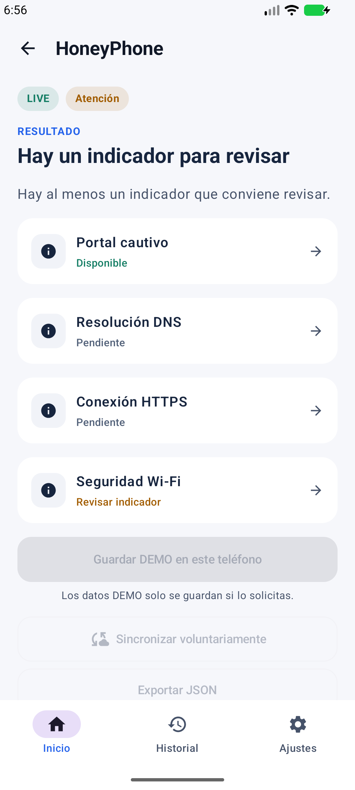

<p align="center">
  
</p>

# HoneyPhone Android

<p align="center"><strong>Indicadores de tu Wi-Fi, explicados con contexto.</strong><br />App nativa Android · Kotlin · Jetpack Compose · Material 3</p>



HoneyPhone ayuda a observar señales disponibles en el teléfono y a guardar revisiones de la red Wi-Fi que estás usando. Presenta cada resultado con sus límites: una diferencia no confirma por sí sola un ataque y una prueba sin destino configurado se muestra como pendiente.

## Funciones

- Lee indicadores Wi-Fi y de portal cautivo que expone Android.
- Ejecuta comprobaciones DNS y HTTPS contra destinos controlados cuando se configuran.
- Guarda historial local, permite exportar revisiones JSON y sincronizarlas manualmente con HoneyPhone Backend.
- Ofrece ejemplos DEMO sintéticos, claramente separados de las lecturas del dispositivo.
- Incluye cuenta con correo/contraseña o Google, gestión de instalaciones y sesiones por usuario.
- Permite activar un señuelo HTTP local para observar solicitudes entrantes en una red autorizada.
- Puede programar revisiones periódicas cuando el usuario activa la opción y hay Wi-Fi e Internet verificado.

La app no escanea otros dispositivos ni modifica la configuración del router. DNS y HTTPS permanecen como `NOT_CONFIGURED` hasta que se definan destinos de prueba controlados.

## Requisitos

- JDK 21
- Android SDK Platform 37 y Platform Tools (`adb`)
- Dispositivo o emulador con Android 10 / API 29 o posterior

La configuración de Gradle define `applicationId` `dev.honeyphone.app`, `minSdk 29`, `targetSdk 36` y `compileSdk 37`.

## Compilar y ejecutar

Desde la raíz del repositorio:

```bash
./gradlew :app:assembleDebug
./gradlew :app:testDebugUnitTest
```

En Windows PowerShell usa `.\gradlew.bat :app:assembleDebug` y `.\gradlew.bat :app:testDebugUnitTest`. El APK debug aparece en `app/build/outputs/apk/debug/app-debug.apk`.

## Conectar con una API local

La app debug usa `http://127.0.0.1:8081/api/v1/`; inicia el backend en el puerto 8000 y crea un puente ADB:

```bash
adb reverse tcp:8081 tcp:8000
```

También puedes ejecutar `scripts/usb-reverse.sh`. El puente se pierde al desconectar o reiniciar el dispositivo. HTTP sin cifrar está limitado a loopback en debug; release mantiene el tráfico cleartext bloqueado.

## Cuenta y credenciales

El acceso requiere una cuenta. Las contraseñas por correo necesitan verificación; también se admite Google Sign-In con el ID de cliente Web. La sesión se protege con Android Keystore y cada cuenta usa su propio archivo Room. Las revisiones quedan locales hasta que la persona decide sincronizarlas.

Para un release configura la URL HTTPS y el ID público OAuth Web:

```bash
export HONEYPHONE_API_BASE_URL='https://api.example.com/api/v1/'
export HONEYPHONE_GOOGLE_WEB_CLIENT_ID='tu-cliente-web.apps.googleusercontent.com'
./gradlew :app:assembleRelease
```

La URL de API no tiene valor por defecto en release. Para firmar el APK, define además las cuatro variables `HONEYPHONE_RELEASE_STORE_FILE`, `HONEYPHONE_RELEASE_STORE_PASSWORD`, `HONEYPHONE_RELEASE_KEY_ALIAS` y `HONEYPHONE_RELEASE_KEY_PASSWORD`. Si faltan todas, el artefacto queda sin firmar; si solo configuras algunas, Gradle detiene el build. No guardes keystores, contraseñas ni secretos OAuth en Git.

## Señuelo HTTP y privacidad

El señuelo escucha en la dirección Wi-Fi del teléfono solo mientras está activo y se detiene al salir de esa sección o de la app. Conserva localmente hasta 100 eventos con IP de origen, método, ruta y familia de User-Agent; no lee ni guarda cuerpos de petición. Al sincronizar, la API recibe IP enmascaradas. Para una prueba, usa únicamente otro dispositivo y una red autorizados; la dirección local usa el puerto `8080`.

La app no recopila SSID, BSSID, ubicación ni credenciales de red. Los datos DEMO proceden de fixtures sintéticas y siempre se identifican como simulación.

## Arquitectura

```text
app/src/main/java/dev/honeyphone/app/
├── ui/             # Compose, navegación, pantallas y ViewModel
├── model/          # señales y modelos de presentación
├── data/           # repositorios locales, DEMO y sincronización
└── core/
    ├── auth/       # sesión segura
    ├── database/   # Room, DAO y migraciones
    ├── honeypot/   # servidor HTTP local y servicio
    ├── network/    # señales Android, sondas y cliente API
    └── work/       # revisiones en segundo plano
```

## Licencia

El código propio de este repositorio se distribuye bajo MIT; consulta [`LICENSE`](LICENSE). Las fuentes empaquetadas tienen sus avisos SIL Open Font License en [`font-licenses/`](font-licenses/), y las dependencias de Android conservan sus licencias respectivas.
